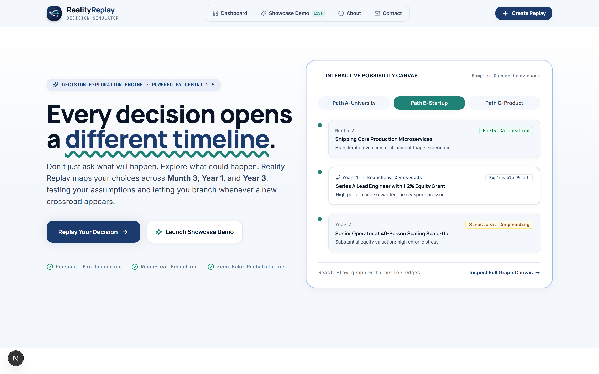
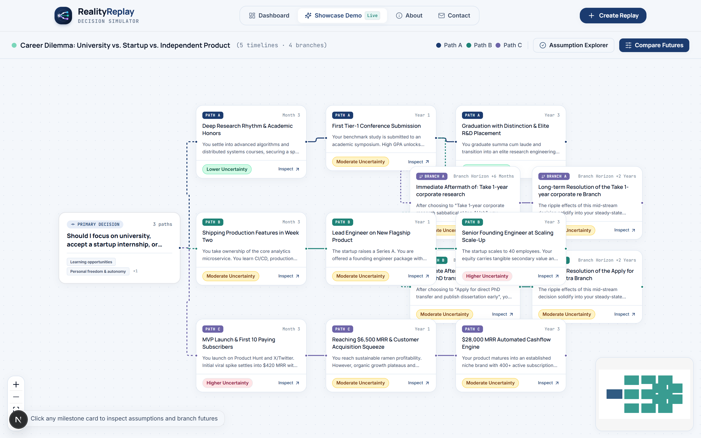
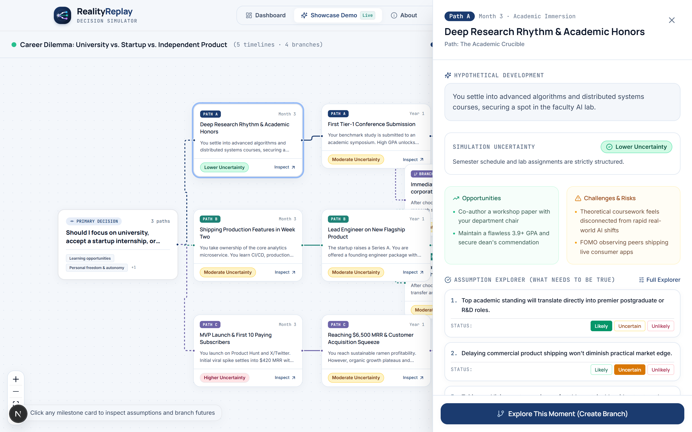
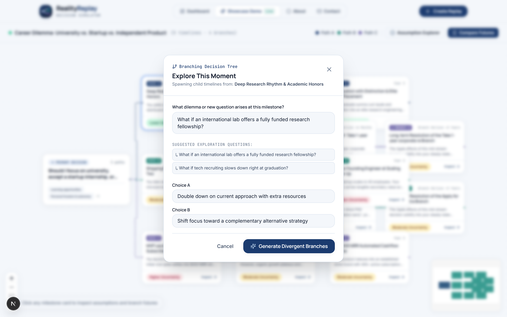
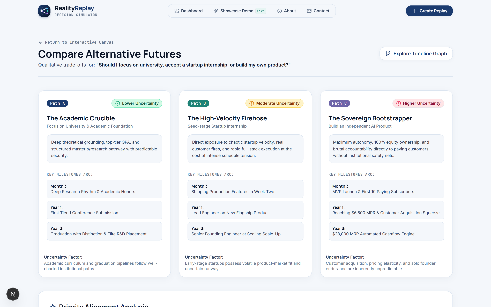
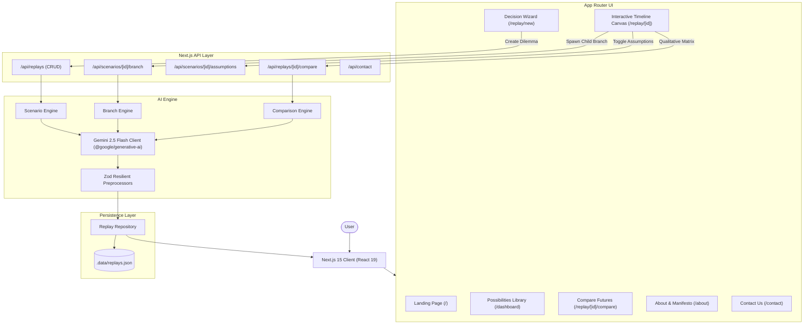

# Reality Replay 🧭

<div align="center">


### *Don't just ask what will happen. Explore what could happen.*

An AI-powered decision exploration platform that transforms one major life or career decision into multiple alternative hypothetical timelines—allowing you to navigate possibilities, stress-test hidden assumptions, and spawn recursive decision branches.

[](https://nextjs.org/)
[](https://react.dev/)
[](https://www.typescriptlang.org/)
[](https://tailwindcss.com/)
[](https://deepmind.google/technologies/gemini/)
[](https://reactflow.dev/)
[](LICENSE)

[**Live Demo**](https://realityreplay.app) · [**Watch Showcase**](#-visual-showcase) · [**Explore Architecture**](#-architecture--system-design) · [**Getting Started**](#-getting-started)

</div>

---

## 🌟 The Vision

Most AI applications try to give users **answers**. **Reality Replay** gives them something far more valuable: **the ability to explore possibilities**.

Every defining life crossroads—leaving a job to launch a company, pursuing a university degree, or relocating across continents—carries multiple viable paths. Once someone chooses one, the alternatives usually remain forever unexplored.

Standard AI chatbots treat personal decisions like factual trivia queries: they output generic pros-and-cons lists or declare one choice objectively superior. Even worse, some products calculate fake numerical probabilities (*"78% chance of career success"*).

**Reality Replay is different:**
- 🚫 **No fake Bayesian percentages** (an LLM cannot reliably calculate true probabilities of a person's life from a prompt).
- 🧭 **Multi-horizon timeline projection** across **Month 3** (initial calibration), **Year 1** (compounding realities), and **Year 3** (lasting structural identity).
- 🔬 **Assumption Explorer (Feature 6)** to mark underlying premises as **Likely**, **Uncertain**, or **Unlikely** and test simulation fragility.
- 🌳 **Recursive Decision Trees (Feature 4)** to pause at any milestone, click *"Explore this moment"*, and branch child timelines into the future.
- ⚖️ **Qualitative Futures Matrix** that compares trade-offs against your personal declared priorities.

---

## 📸 Visual Showcase

### 1. Interactive Landing Page & Live Dilemma Sandbox
> Experience the contrast between traditional chatbots and multi-timeline possibility exploration.
<p align="center">
  
</p>

### 2. Multi-Horizon Timeline Graph Canvas (`@xyflow/react`)
> An explorable node graph mapping Month 3, Year 1, and Year 3 milestones across divergent paths.
<p align="center">
  
</p>

### 3. Milestone Node Inspection Drawer
> Click any milestone node to inspect hypothetical developments, opportunities, challenges, and catalysts.
<p align="center">
  
</p>

### 4. Assumption Explorer (Feature 6)
> Stress-test the simulation: mark assumptions as Likely, Uncertain, or Unlikely to expose vulnerabilities.
<p align="center">
  
</p>

### 5. Recursive Decision Tree Branching (Feature 4)
> Spawn child timelines directly from pivotal turning points in any scenario.
<p align="center">
  
</p>

### 6. Compare Futures & Qualitative Priority Alignment
> Understand trade-offs across financial stability, autonomy, and risk without artificial declarations of superiority.
<p align="center">
  
</p>

---
## 🌐 Live URL
https://realityreplay-ai.vercel.app/

## 🚀 Key Features

### 🏛️ Layer A — Essential Experience
- **Guided Decision Architecture:** 4-step wizard collecting user occupation, industry, experience tier, financial runway, and risk profile before framing options.
- **Dilemma Diagnostics:** Deep psychological probes into primary motivations, worst-case fears, and stakeholders impacted.
- **Priority Calibration:** Users select up to 3 core priorities (e.g., Financial Stability, Learning Velocity, Personal Autonomy) to anchor the analysis.

### 🧠 Layer B — Intelligence & Scenario Engine
- **Powered by Google Gemini 2.5 Flash:** Generates 3 distinct, balanced multi-milestone paths per dilemma with structured Zod schema validation.
- **Chronological Milestones:**
  - **Month 3:** Early adaptations, operating rhythms, initial friction.
  - **Year 1:** Compounding consequences, first major crossroads, resource strains.
  - **Year 3:** Steady-state identity, trade-offs, and career positioning.
- **Qualitative Uncertainty Bands:** Categorizes volatility as *Lower*, *Moderate*, or *Higher* with explicit reasoning.

### 🌿 Layer C — Interactive Exploration & Feedback Loops
- **Assumption Explorer:** Directly toggle assumptions (`likely` / `uncertain` / `unlikely`) to evaluate timeline fragility. Add custom user-defined premises on the fly.
- **Recursive Branching Engine:** Select any milestone, define a new sub-dilemma, and project child paths that stay attached to the parent graph.
- **Side-by-Side Comparison Matrix:** Qualitative table analyzing financial ceiling, autonomy, downside risk, and alignment with stated priorities.
- **Possibilities Library (Dashboard):** Search, filter by branch count, and manage all your historical decision explorations with persistent storage.

---

## 🏗️ Architecture & System Design



---

## 🛠️ Tech Stack

| Category | Technology | Purpose |
| :--- | :--- | :--- |
| **Framework** | [Next.js 15](https://nextjs.org/) (App Router) | React Server Components, server actions, route handlers |
| **UI Library** | [React 19](https://react.dev/) | Declarative component UI |
| **Language** | [TypeScript](https://www.typescriptlang.org/) (Strict) | End-to-end type safety |
| **Interactive Graph** | [`@xyflow/react`](https://reactflow.dev/) (v12) | Node canvas, minimap, drag/pan/zoom layout |
| **AI Scenario Model** | [Google Gemini 2.5 Flash](https://deepmind.google/technologies/gemini/) | High-speed structured JSON scenario generation |
| **Styling** | [Tailwind CSS](https://tailwindcss.com/) | Custom "Quiet Futures" light-theme palette |
| **Motion** | [Framer Motion](https://www.framer.com/motion/) | Smooth springs, page transitions, drawer animations |
| **Validation** | [Zod](https://zod.dev/) | Strict JSON schema parsing and error recovery |
| **Icons** | [Lucide React](https://lucide.dev/) | Clean UI iconography |
| **Testing & Visuals** | [Puppeteer Core](https://pptr.dev/) | Automated 2x Retina showcase snapshot generation |

---

## 🏁 Getting Started

### Prerequisites
- **Node.js**: v18.18 or higher (v20+ recommended)
- **npm** or **pnpm**
- *(Optional)* A Google Gemini API Key from [Google AI Studio](https://aistudio.google.com/)

### 1. Clone the Repository
```bash
git clone https://github.com/IHassanshaikh/reality-replay.git
cd reality-replay
```

### 2. Install Dependencies
```bash
npm install
```

### 3. Configure Environment Variables
Copy the template environment file:
```bash
cp .env.example .env.local
```
Open `.env.local` and add your Google Gemini API key:
```env
GEMINI_API_KEY=your_gemini_api_key_here
```
*(Note: If unset, Reality Replay runs seamlessly in intelligent fallback simulation mode with pre-calibrated scenario sets).*

### 4. Run the Development Server
```bash
npm run dev
```
Open [http://localhost:3000](http://localhost:3000) in your browser to start exploring decisions.

### 5. Production Build
```bash
npm run build
npm run start
```

---

## 📁 Project Structure

```text
reality-replay/
├── .data/                        # Persistent local JSON datastore
│   └── replays.json
├── public/                       # Static public assets
│   ├── favicon.svg               # SVG browser tab icon
│   ├── logo.svg                  # Vector divergent path logo
│   └── site.webmanifest          # PWA manifest
├── scripts/                      # Automated capture utilities
│   └── capture-showcase.js       # Headless Chrome 2x Retina pipeline
├── showcase/                     # High-resolution showcase screenshots
│   ├── 01_landing_hero.png
│   ├── 06_canvas_overview.png
│   ├── 08_assumption_explorer.png
│   └── 10_compare_futures.png
├── src/
│   ├── app/                      # Next.js 15 App Router
│   │   ├── about/                # About Us & Creator Manifesto
│   │   ├── api/                  # Backend REST API routes
│   │   │   ├── contact/          # Message routing
│   │   │   ├── replays/          # Replay CRUD & comparison
│   │   │   └── scenarios/        # Branching & assumption endpoints
│   │   ├── contact/              # Interactive contact page
│   │   ├── dashboard/            # Possibilities Library
│   │   ├── privacy/              # Privacy policy
│   │   ├── replay/
│   │   │   ├── [id]/             # Interactive Canvas & Compare view
│   │   │   └── new/              # Decision Creation Wizard
│   │   ├── terms/                # Terms of Service & AI ethics
│   │   ├── error.tsx             # Global error boundary
│   │   ├── layout.tsx            # Root layout, JSON-LD schema & meta
│   │   ├── not-found.tsx         # Custom 404 ("Uncharted Vector")
│   │   ├── robots.ts             # Search engine crawler directives
│   │   └── sitemap.ts            # Dynamic sitemap
│   ├── components/
│   │   ├── comparison/           # Qualitative comparison components
│   │   ├── dashboard/            # Library list, filters & search
│   │   ├── decision-builder/     # 4-step wizard forms
│   │   ├── landing/              # Hero, sandbox, matrices & FAQs
│   │   ├── replay-canvas/        # React Flow canvas, drawer & modals
│   │   │   ├── nodes/            # Custom milestone & root nodes
│   │   │   ├── AssumptionExplorerModal.tsx
│   │   │   ├── BranchCreationModal.tsx
│   │   │   └── ScenarioDrawer.tsx
│   │   └── shared/               # Logo, Navbar, Footer, Badges
│   ├── lib/
│   │   ├── constants/            # Design tokens & color palettes
│   │   ├── layout/               # Tree layout calculation algorithm
│   │   └── validations/          # Zod schemas for decisions & scenarios
│   ├── services/
│   │   ├── ai/                   # Gemini client, engines & prompts
│   │   └── database/             # In-memory & file repository
│   └── types/                    # Core TypeScript data contracts
├── .env.example
├── package.json
├── tailwind.config.ts
└── tsconfig.json
```

---

## 🛡️ Ethics & AI Disclaimers

Reality Replay is designed as an interactive thought experiment and strategic reflection tool. All projected milestones, turning points, and trade-offs are **hypothetical simulations generated by artificial intelligence**. 

Reality Replay does not claim to predict the future with factual certainty. Outputs must never replace qualified financial, legal, investment, psychological, or medical counsel. We actively reject misleading numerical success percentages in favor of transparent, qualitative uncertainty factors.

---

## 👨‍💻 Creator & Contact

Designed, developed, and maintained by **Hassan Shaikh**:

- 📧 **Email:** [hassanshaikh9717@gmail.com](mailto:hassanshaikh9717@gmail.com)
- 📸 **Instagram:** [@hassan.techlife](https://instagram.com/hassan.techlife)
- 🐙 **GitHub:** [@IHassanshaikh](https://github.com/IHassanshaikh)

---

## 📄 License

This project is open-source under the [MIT License](LICENSE).
